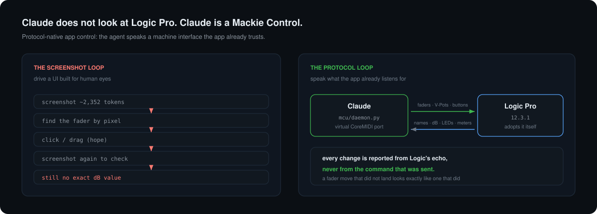
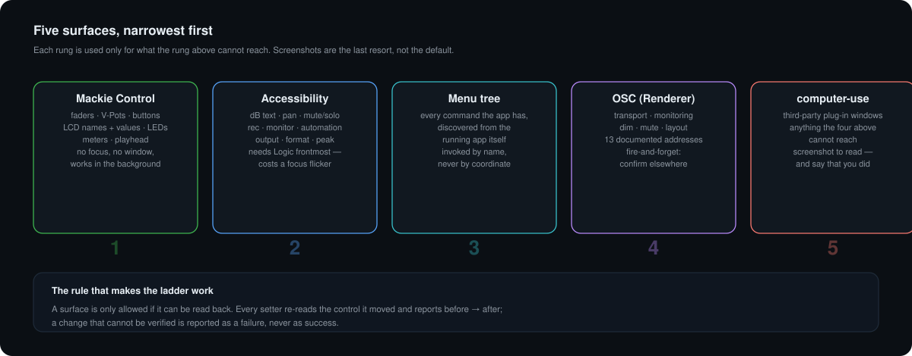
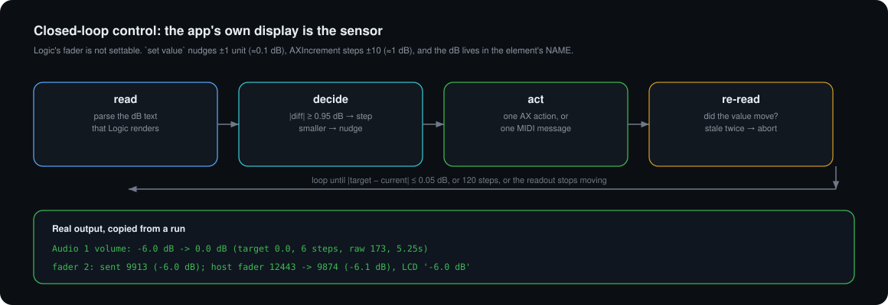
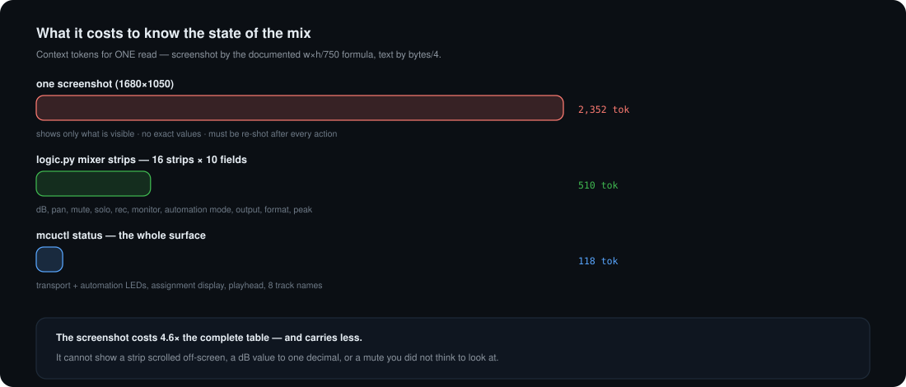
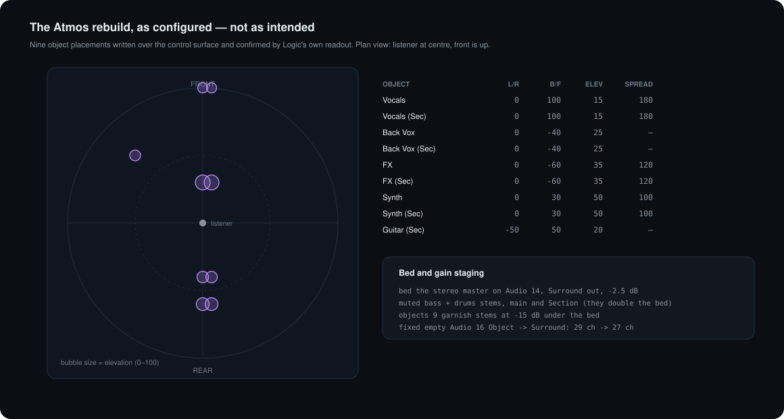
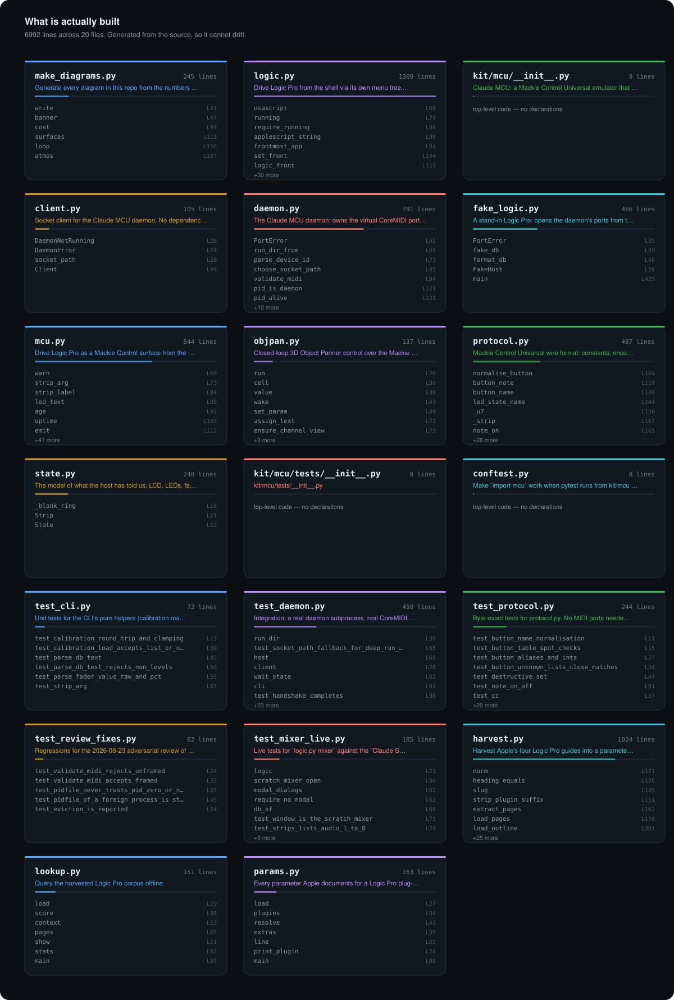

**An AI agent configured a finished Dolby Atmos music master in Logic Pro — 15 tracks mapped, 9 spatial objects placed, a 27-channel ADM BWF exported and chunk-verified — without taking a single screenshot or moving the cursor once.** It did it by becoming a Mackie Control: a virtual MIDI device Logic adopts on its own and streams its entire mix state to.

*This is not "AI mixing". Every creative decision — placement map, levels, the final listen — is the human's. This is about the **interface** between an agent and an application: replacing a UI built for human eyes with a protocol built for machines.*

---

## The problem, stated honestly

The default way an agent uses a desktop app is to screenshot it, find a control by pixel, click, and screenshot again. It works. It is also slow, expensive, and structurally blind — and when it fails it fails silently.

Here is a real failure from this project's own logs. The agent clicked one mute button. Then it read the mixer back:

```
strip       dB   raw    pan  mute  solo
Audio 1     0.0  173.0  0    on    off      ← not asked for
Audio 2     0.0  173.0  0    on    off      ← not asked for
Audio 3     0.0  173.0  0    on    off      ← the one that was clicked
Audio 4     0.0  173.0  0    on    off      ← not asked for
...all eight strips muted...
```

Logic applies an edit to **every selected channel strip**. Eight tracks were selected, so one click muted eight. A screenshot taken immediately after would have shown eight lit mute buttons — and an agent that trusted its own action would have reported "muted Audio 3" and moved on.

The obvious fix is a better screenshot loop: zoom in, verify pixels, retry. The author's own notes from the previous GUI-driven build of this same song say what that costs:

> "numeric fields in panner (dbl-click, type, **ZOOM-VERIFY every entry — entries silently miss ~20% of the time**) … Re-derive x-coords per session — channel count changes shift everything."

A 20% silent miss rate on parameter entry is not a tooling problem to be papered over. It is a signal that the interface is wrong.

## How it works



Three ideas, in order of how much they matter.

**1 · Speak an interface the app already trusts.** Logic Pro has shipped Mackie Control Universal support for two decades. It is a MIDI protocol: faders are pitch-bend, buttons are note-on, the 8×2 character LCD arrives as SysEx, meters as channel pressure. [`kit/mcu/daemon.py`](kit/mcu/daemon.py) opens a *virtual* CoreMIDI port pair named `Claude MCU` and speaks it. Logic probes every new MIDI port, recognises the handshake, and adopts the surface **by itself** — no configuration, no Setup window. From that moment Logic pushes its own state at us: track names, fader positions, every LED, the assignment display, the playhead, the meters. We push back faders, V-Pot turns and button presses. No focus, no window, no pixels. Logic can be in the background; the human can keep using the Mac.

**2 · The app's own display is the sensor.** Nothing is reported from the command that was sent. A fader move is reported from the *echo* Logic sends back; a mute from the LED Logic lights; a dB value from the text Logic renders. Where a control has no absolute setter — Logic's fader is a nudge, not a set — the agent runs a closed loop: read, decide, act, re-read, until the app's own readout says the target was reached, or the loop gives up and says so.



**3 · Documentation becomes queryable data, not memory.** Apple's four Logic Pro guides (2,686 pages) are harvested into 3,048 topic records and **7,447 parameter records** — one per documented control, with its type, choices and page number. Before touching a parameter the agent looks it up. This is what let it discover, mid-session, that a second press of STOP returns the playhead to the project start — a fact it did not know and did not guess.

```bash
$ python3 reference/kit/params.py Compressor
Compressor — 39 parameters  (effects, effects guide)
# Compressor main parameters  (p.90–91)
  Circuit Type | buttons | Choose the type of circuit emulated by Compressor…
      {choices: Platinum Digital | Studio VCA and FET | Classic VCA | Vintage VCA, FET, and Opto}
  Threshold | knob and field | Set the threshold level—signals above this threshold are reduced…
```

## Which model did what

This repo is also a record of an agent building its own tools. Two Claude models, different jobs:

| Model | Role | Evidence |
|---|---|---|
| **Claude Fable 5** | Wrote the protocol implementation and its tests as parallel subagents — `protocol.py`, `state.py`, `daemon.py`, `client.py`, `mcu.py`, `fake_logic.py` and 78 tests in one pass; later the documentation harvester. Also ran the adversarial review that found six real defects in its own output. | ~5,400 lines of the code in `kit/`, plus the review findings now fixed in `daemon.py` |
| **Claude Opus 5** | Orchestrated those subagents, then drove the live session: probed Logic's accessibility tree by hand, mapped the MCU semantics against Apple's documentation, ran the Atmos rebuild, and verified every result. | the live findings table below; `kit/logic.py`; `kit/mcu/objpan.py` |

The division is deliberate and reproducible: a fast model writes well-specified code against a written protocol spec; a slower orchestrator holds the live state, keeps the discipline, and refuses to report what it did not read back.

## The measurement that justifies it



| | screenshot loop | protocol surface |
|---|---|---|
| Read the full mix state | ≥1 screenshot at **2,352 tokens**, values not readable to one decimal, hidden strips invisible | **510 tokens**, 16 strips × 10 fields, exact |
| Read transport + LEDs + playhead + names | another screenshot | **118 tokens** |
| Set a fader to exactly −6.0 dB | type, zoom, verify; ~20% silent miss rate (author's own prior notes) | closed loop, **6 steps / 5.25 s**, echo-confirmed |
| Know a change landed | compare two images | Logic's own echo: `host fader 12443 -> 9874 (-6.1 dB), LCD '-6.0 dB'` |
| While it works | the agent owns the screen | Logic can be in the background |
| Wrong-target risk | invisible (see the eight-mute failure above) | setter deselects first, then re-reads |

The screenshot number uses the documented vision formula (width × height ÷ 750) for a 1680×1050 display. The text numbers are the actual byte counts of the real command output divided by four. Both are reproducible from this repo.

## Proof: a real Atmos master, built by protocol



One session, one real song, no screenshots. Full log in [`docs/CASE-STUDY-ATMOS.md`](docs/CASE-STUDY-ATMOS.md).

| Step | How it was done | Verified by |
|---|---|---|
| Map 15 tracks to their regions | accessibility tree of the Tracks area | region names, which contradicted the track names — as the author's notes warned |
| Reset Spatial Audio (off → Dolby Atmos) | Project Settings pop-up | pop-up read back `Dolby Atmos`, 7.1.2, 48 kHz |
| Answer Logic's conversion alert | **the alert appeared on the MCU LCD**; a V-Pot push under "OK" answered it | LCD cleared, settings applied |
| Bed at −2.5 dB, 4 stems muted, 9 objects at −15 dB | MCU faders + accessibility mutes | every value re-read from the Mixer |
| 9 object placements (spread / L-R / B-F / elevation) | [`objpan.py`](kit/mcu/objpan.py) closed loop over the Pan Channel view | Logic's own parameter readout, per parameter |
| Remove stray silent objects | empty track Object → Surround | export dropped **29 ch → 27 ch** |
| Export ADM BWF | `File > Export > Project as Spatial Audio…` | RIFF parse: `fmt` 27 ch/48 kHz/24-bit, **axml + chna + dbmd present**, 142.0 s |

The measured result: `552 MB`, 27 channels, all three ADM metadata chunks present, duration matching the song. Pending the one thing an agent must never do — the human's listen.

## What is actually built



The map above is generated by parsing this repository's source — 6,992 lines across 20 files, 295 symbols — so it cannot drift from the code. Regenerate with `python3 ~/.claude/skills/repo-taste/kit/mkmap.py .`; the full symbol index with line anchors is in [`docs/ARCHITECTURE.md`](docs/ARCHITECTURE.md).

| File | What it owns |
|---|---|
| [`kit/mcu/protocol.py`](kit/mcu/protocol.py) | The wire format. 117 named buttons, encode/decode for every message either side sends, and a `decode()` that never raises on garbage. Zero I/O — importable and testable without MIDI. |
| [`kit/mcu/state.py`](kit/mcu/state.py) | The model of what the host has told us: 8 strips, LCD buffer, LED map, 7-segment displays, meters, handshake stage. |
| [`kit/mcu/daemon.py`](kit/mcu/daemon.py) | Owns the virtual ports and the state; serves a unix socket. Framing validation, gesture locking, ring-buffer eviction reporting, pid-verified shutdown. |
| [`kit/mcu/mcu.py`](kit/mcu/mcu.py) | The CLI (`mcuctl`): status, lcd, strips, leds, fader, mute/solo/select, transport, automation, banking, calibration, watch. |
| [`kit/mcu/objpan.py`](kit/mcu/objpan.py) | Closed-loop 3D Object Panner control — the piece that placed the nine Atmos objects. |
| [`kit/mcu/fake_logic.py`](kit/mcu/fake_logic.py) | A fake host that opens the other side of the ports, so the whole protocol is testable with Logic closed. |
| [`kit/logic.py`](kit/logic.py) | The accessibility + menu-tree surface: `mixer` commands, live menu discovery, focus handling, setter isolation. |
| [`reference/kit/harvest.py`](reference/kit/harvest.py) | Turns Apple's PDFs into the topic and parameter corpora. |

**Reading order**, if you want to understand it rather than run it:

1. [`protocol.py#L378`](kit/mcu/protocol.py#L378) — `decode()`: every message Logic can send, turned into a dict. Start here; the rest is plumbing around it.
2. [`protocol.py#L110`](kit/mcu/protocol.py#L110) — `button_note()`: names to note numbers, and why `rec*`/`record`/`replace`/`drop` are guarded.
3. [`state.py#L148`](kit/mcu/state.py#L148) — `State.apply()`: how a stream of events becomes a picture of the mix.
4. [`daemon.py#L94`](kit/mcu/daemon.py#L94) — `validate_midi()`: the fix for the nastiest bug in the repo (see below).
5. [`daemon.py#L436`](kit/mcu/daemon.py#L436) — `cmd_wait()`: how a client blocks until Logic confirms something, and how eviction is reported rather than hidden.
6. [`mcu.py#L131`](kit/mcu/mcu.py#L131) — `Calibration`: fader units ↔ dB, learned by sweeping Logic's own readout.
7. [`logic.py#L711`](kit/logic.py#L711) — `set_volume()`: the closed loop, including the stale-readout abort.
8. [`logic.py#L416`](kit/logic.py#L416) — `AS_ISOLATE`: three lines that prevent the eight-mute failure.
9. [`objpan.py#L79`](kit/mcu/objpan.py#L79) — `ensure_channel_view()`: why one missing period in a two-character display would have edited the wrong track.

## Install and use

Requires macOS with Logic Pro, Python 3.11+, and `python-rtmidi`. Nothing else.

```bash
python3 -m venv kit/.venv && kit/.venv/bin/pip install python-rtmidi pytest
kit/mcuctl daemon start        # opens the virtual ports; Logic finds them in seconds
kit/mcuctl status
```

```
daemon:    running, pid 19884, up 3h06m, ports 'Claude MCU' (device id 0x14), 10569 events
handshake: queried (3.0h ago)   online: no   last host message: 1m ago (10523 total)
transport: play=off  stop=on  record=off  rewind=off  fast_fwd=off  cycle=off
auto:      read_off=on  write=off  trim=off  touch=off  latch=off  group=off
display:   assign 'PN'   time '  1 1 1  1' (beats)
strips:    1 Audio1  2 Audio2  3 Audio3  4 Audio4  5 Audio5  6 Audio6  7 Audio7  8 Audio8
```

```bash
kit/mcuctl lcd                 # both LCD rows, 8 columns: names over values
kit/mcuctl strips              # names, faders, dB, LEDs, V-Pot rings, meters
kit/mcuctl calibrate 1         # once: learn fader units ↔ dB from Logic's own readout
kit/mcuctl fader 3 -6          # then dB works
kit/mcuctl mute 3 on           # idempotent: presses only if Logic's LED disagrees
kit/mcuctl transport play
kit/mcuctl watch --seconds 10  # every decoded host message, live
```

```
$ kit/mcuctl fader 2 -6
fader 2: sent 9913 (-6.0 dB); host fader 12443 -> 9874 (-6.1 dB), LCD '-6.0 dB'
```

The accessibility surface, for what MIDI cannot reach:

```bash
python3 kit/logic.py mixer strips
python3 kit/logic.py mixer set "Audio 3" volume -6.0
python3 kit/logic.py find bounce          # discover commands from the running app
```

Tests — 96 of them run with Logic closed, against the fake host:

```bash
cd kit/mcu && ../.venv/bin/python -m pytest -q tests      # 96 passed
cd kit && ./.venv/bin/python -m pytest -q tests           # 11 live tests, needs a scratch project
```

## What we learned the hard way

Every row cost a debugging cycle. None of it is in any documentation.

| Symptom | The actual cause |
|---|---|
| One mute click muted all eight strips | Logic applies mute/solo/fader edits to **every selected strip**; fader moves are relative across the selection. Setters now raise the Mixer and *Deselect All* first. |
| `set value` on a fader moved it 0.1 dB regardless of the value sent | Logic's fader slider is not absolute over accessibility. `set value` = ±1 unit nudge; `AXIncrement` = ±10 units ≈ 1 dB. The dB itself lives in the **name** of the level field, not its value. Hence the closed loop. |
| Every accessibility call failed with "window not found", intermittently | Logic exposes its windows to accessibility **only while it is frontmost**, and another app stealing focus mid-script breaks a lookup between two statements. Fixed by activating for the operation, waiting for the window list to populate, retrying inside AppleScript, and handing focus back. |
| An MCU test could have armed a real track | Logic probes *every* new MIDI port and would adopt a test daemon as a real control surface. Tests now use device id `0x7E` and a pid-unique port name, so Logic ignores them. |
| `send([0x90, 0xDF, 0x7F])` was logged as "press 0xDF" but Logic received **RECORD** | An 8-bit data byte is re-parsed by CoreMIDI into a new status byte, bypassing the CLI's `--yes` guard entirely. [`validate_midi()`](kit/mcu/daemon.py#L94) now refuses any unframed message — and an unterminated SysEx, which silently swallows every later message. |
| Two clients pressing buttons at once produced Shift+Play | Gestures (modifier down → button → up) were not serialised. A gesture lock now makes them atomic. |
| `daemon stop` would have killed an unrelated process | The pidfile was trusted blindly; a reused pid, or a corrupt file containing `0`/`-1`, would have signalled the wrong target — `os.kill(-1, …)` kills everything the user owns. Now the pid must verify as one of ours. |
| A burst of meter traffic silently dropped 600 events | The event ring evicts; `events since=N` reported `more: false` regardless. It now reports how many were evicted so a client can resync. |
| Calibration read `-57.4 d` as "not a level" | Logic truncates `dB` to `d` when the value does not fit the 7-character LCD cell. |
| V-Pot turns edited the wrong track | In Pan **Mixer** view each V-Pot is a *different strip's* pan; only in Pan **Channel** view are they the selected strip's object parameters. The two are distinguished by a single period in the assignment display: `PN` vs `PN.`. |
| Output assignment "committed" but nothing changed | The MCU preselect flashes until a V-Pot push confirms it, and the value list wraps: `Surr. L/R → Surround → No Output → Stereo → Bus 1…256`. There is **no `Object` entry** — object routing cannot be assigned from a control surface at all. That is a real ceiling, not a bug, and it is why object routing is never flattened. |
| A modal alert blocked everything and could not be seen | Logic **mirrors its alert dialogs onto the MCU LCD**, and a V-Pot push under the on-screen button answers them. The blindest moment turned into a readable one. |
| Logic sat at 100% CPU with no windows after a reboot | Its configured audio interface was absent. Logic loops in `MDCA::Init` until the device returns — diagnosable in seconds with `sample`, invisible to a screenshot. |
| Accessibility element names changed mid-session | Logic 12.3.1 alternates between human-readable (`volume fader`) and identifier-style (`volumeFader`) descriptions. Both are now accepted — and the identifier form exposes the **actual peak dB**, which the readable form does not. |

## What this is not

- **Not a general "AI controls any app" system.** It works because Logic ships a documented control-surface protocol. The transferable part is the *method*: find the machine interface the app already exposes, and only fall back to pixels for what it genuinely cannot reach.
- **Not autonomous music-making.** The placement map, the levels and the final approval are the human's. The agent does mechanics and verification.
- **Not a Logic plug-in or a patch.** Nothing is injected into Logic. It is a MIDI device and the macOS accessibility API — both public, both supported.
- **Not tested beyond one machine.** Logic Pro 12.3.1, macOS 15 (Darwin 24.6), Python 3.14, one project. The MCU implementation is deliberately version-agnostic, but nothing here has been run on Logic 11 or on another Mac.
- **The documentation corpora are not redistributed.** [`reference/kit/harvest.py`](reference/kit/harvest.py) builds them from *your* copies of Apple's PDFs. The harvested `.jsonl` files are gitignored; Apple's documentation is Apple's.

## Documentation

| Document | What is in it |
|---|---|
| [`docs/METHOD.md`](docs/METHOD.md) | The methodology in full: the surface ladder, the read-back rule, how to apply it to an app that is not Logic. |
| [`docs/PROTOCOL.md`](docs/PROTOCOL.md) | The MCU wire format as implemented, plus the Logic-specific semantics that are not in any protocol document. |
| [`docs/CASE-STUDY-ATMOS.md`](docs/CASE-STUDY-ATMOS.md) | The Atmos rebuild, step by step, with the real command output. |
| [`docs/ARCHITECTURE.md`](docs/ARCHITECTURE.md) | Generated symbol index — every declaration with a line anchor. |

## Credits

- **Mackie Control Universal** — protocol by Mackie Designs; Logic Pro's implementation of it is Apple's, documented in the *Control Surfaces Support Guide for Logic Pro*, which is the source for every host-behaviour claim here.
- **[python-rtmidi](https://github.com/SpotlightKid/python-rtmidi)** (Chris Arndt) and **[RtMidi](https://github.com/thestk/rtmidi)** (Gary P. Scavone) — the CoreMIDI binding. Unmodified.
- **Apple** — Logic Pro, the accessibility APIs, and the four user guides the reference corpus is built from.
- **Dolby** — the Atmos Renderer and its OSC surface, used by a sibling skill that is not vendored here.
- Built with **Claude Code**; the code in `kit/` was written by **Claude Fable 5** subagents and driven live by **Claude Opus 5**.

Proprietary. Copyright (c) 2026 Chandandeep Sharma. All rights reserved. See [LICENSE](LICENSE). Use requires a written license or a marketplace purchase; buyers receive the rights stated in that sale agreement.

Logic Pro is a trademark of Apple Inc. Dolby Atmos is a trademark of Dolby Laboratories. Mackie Control is associated with Mackie Designs. Not affiliated with Apple, Dolby, or Mackie. Names appear only as descriptive compatibility mentions.

If you extend it, the one rule worth keeping is the one that made it work: **never report a change you did not read back.**