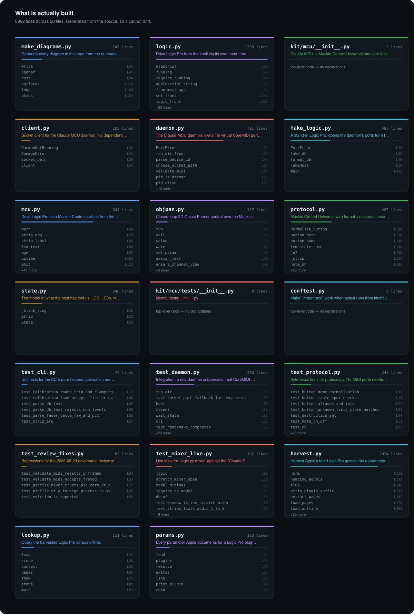

# Architecture

> Generated by `mkmap.py` from the source. Do not edit by hand.

<p align="center"></p>

| file | lines | symbols |
|---|---:|---:|
| [`assets/make_diagrams.py`](../assets/make_diagrams.py) | 245 | 6 |
| [`kit/logic.py`](../kit/logic.py) | 1309 | 37 |
| [`kit/mcu/__init__.py`](../kit/mcu/__init__.py) | 9 | 0 |
| [`kit/mcu/client.py`](../kit/mcu/client.py) | 105 | 4 |
| [`kit/mcu/daemon.py`](../kit/mcu/daemon.py) | 791 | 17 |
| [`kit/mcu/fake_logic.py`](../kit/mcu/fake_logic.py) | 466 | 5 |
| [`kit/mcu/mcu.py`](../kit/mcu/mcu.py) | 844 | 48 |
| [`kit/mcu/objpan.py`](../kit/mcu/objpan.py) | 137 | 10 |
| [`kit/mcu/protocol.py`](../kit/mcu/protocol.py) | 487 | 35 |
| [`kit/mcu/state.py`](../kit/mcu/state.py) | 240 | 3 |
| [`kit/mcu/tests/__init__.py`](../kit/mcu/tests/__init__.py) | 0 | 0 |
| [`kit/mcu/tests/conftest.py`](../kit/mcu/tests/conftest.py) | 8 | 0 |
| [`kit/mcu/tests/test_cli.py`](../kit/mcu/tests/test_cli.py) | 72 | 6 |
| [`kit/mcu/tests/test_daemon.py`](../kit/mcu/tests/test_daemon.py) | 450 | 30 |
| [`kit/mcu/tests/test_protocol.py`](../kit/mcu/tests/test_protocol.py) | 244 | 27 |
| [`kit/mcu/tests/test_review_fixes.py`](../kit/mcu/tests/test_review_fixes.py) | 62 | 5 |
| [`kit/tests/test_mixer_live.py`](../kit/tests/test_mixer_live.py) | 185 | 16 |
| [`reference/kit/harvest.py`](../reference/kit/harvest.py) | 1024 | 32 |
| [`reference/kit/lookup.py`](../reference/kit/lookup.py) | 151 | 7 |
| [`reference/kit/params.py`](../reference/kit/params.py) | 163 | 7 |

## Symbols

### `make_diagrams.py`
*Generate every diagram in this repo from the numbers it cites.*

- `write` <sub>func · [L41](../assets/make_diagrams.py#L41)</sub>
- `banner` <sub>func · [L47](../assets/make_diagrams.py#L47)</sub>
- `cost` <sub>func · [L94](../assets/make_diagrams.py#L94)</sub>
- `surfaces` <sub>func · [L119](../assets/make_diagrams.py#L119)</sub>
- `loop` <sub>func · [L156](../assets/make_diagrams.py#L156)</sub>
- `atmos` <sub>func · [L187](../assets/make_diagrams.py#L187)</sub>

### `logic.py`
*Drive Logic Pro from the shell via its own menu tree. No dependencies.*

- `osascript` <sub>func · [L60](../kit/logic.py#L60)</sub>
- `running` <sub>func · [L79](../kit/logic.py#L79)</sub>
- `require_running` <sub>func · [L84](../kit/logic.py#L84)</sub>
- `applescript_string` <sub>func · [L89](../kit/logic.py#L89)</sub>
- `frontmost_app` <sub>func · [L94](../kit/logic.py#L94)</sub>
- `set_front` <sub>func · [L104](../kit/logic.py#L104)</sub>
- `logic_front` <sub>class · [L113](../kit/logic.py#L113)</sub>
- `name_list` <sub>func · [L144](../kit/logic.py#L144)</sub>
- `top_menus` <sub>func · [L162](../kit/logic.py#L162)</sub>
- `menu_items` <sub>func · [L166](../kit/logic.py#L166)</sub>
- `click_path` <sub>func · [L193](../kit/logic.py#L193)</sub>
- `send_key` <sub>func · [L215](../kit/logic.py#L215)</sub>
- `windows` <sub>func · [L247](../kit/logic.py#L247)</sub>
- `mixer_script` <sub>func · [L425](../kit/logic.py#L425)</sub>
- `strip_key` <sub>func · [L498](../kit/logic.py#L498)</sub>
- `run_mixer` <sub>func · [L508](../kit/logic.py#L508)</sub>
- `mixer_window` <sub>func · [L529](../kit/logic.py#L529)</sub>
- `modal_dialogs` <sub>func · [L548](../kit/logic.py#L548)</sub>
- `strip_names` <sub>func · [L557](../kit/logic.py#L557)</sub>
- `parse_db` <sub>func · [L567](../kit/logic.py#L567)</sub>
- `_num` <sub>func · [L577](../kit/logic.py#L577)</sub>
- `_onoff` <sub>func · [L584](../kit/logic.py#L584)</sub>
- `decode_strip` <sub>func · [L588](../kit/logic.py#L588)</sub>
- `read_strips` <sub>func · [L653](../kit/logic.py#L653)</sub>
- `read_strip` <sub>func · [L664](../kit/logic.py#L664)</sub>
- `fmt_db` <sub>func · [L669](../kit/logic.py#L669)</sub>
- `jsonable` <sub>func · [L677](../kit/logic.py#L677)</sub>
- `print_strips_table` <sub>func · [L691](../kit/logic.py#L691)</sub>
- `set_volume` <sub>func · [L711](../kit/logic.py#L711)</sub>
- `set_pan` <sub>func · [L781](../kit/logic.py#L781)</sub>
- `set_toggle` <sub>func · [L813](../kit/logic.py#L813)</sub>
- `read_peak` <sub>func · [L829](../kit/logic.py#L829)</sub>
- `dump_tree` <sub>func · [L839](../kit/logic.py#L839)</sub>
- `popup_button_selector` <sub>func · [L861](../kit/logic.py#L861)</sub>
- `popup_explore` <sub>func · [L914](../kit/logic.py#L914)</sub>
- `mixer_main` <sub>func · [L982](../kit/logic.py#L982)</sub>
- `main` <sub>func · [L1168](../kit/logic.py#L1168)</sub>

### `client.py`
*Socket client for the Claude MCU daemon. No dependencies.*

- `DaemonNotRunning` <sub>class · [L20](../kit/mcu/client.py#L20)</sub>
- `DaemonError` <sub>class · [L24](../kit/mcu/client.py#L24)</sub>
- `socket_path` <sub>func · [L28](../kit/mcu/client.py#L28)</sub>
- `Client` <sub>class · [L44](../kit/mcu/client.py#L44)</sub>

### `daemon.py`
*The Claude MCU daemon: owns the virtual CoreMIDI ports, keeps State, serves a socket.*

- `PortError` <sub>class · [L65](../kit/mcu/daemon.py#L65)</sub>
- `run_dir_from` <sub>func · [L69](../kit/mcu/daemon.py#L69)</sub>
- `parse_device_id` <sub>func · [L73](../kit/mcu/daemon.py#L73)</sub>
- `choose_socket_path` <sub>func · [L85](../kit/mcu/daemon.py#L85)</sub>
- `validate_midi` <sub>func · [L94](../kit/mcu/daemon.py#L94)</sub>
- `pid_is_daemon` <sub>func · [L121](../kit/mcu/daemon.py#L121)</sub>
- `pid_alive` <sub>func · [L131](../kit/mcu/daemon.py#L131)</sub>
- `Daemon` <sub>class · [L143](../kit/mcu/daemon.py#L143)</sub>
- `setup_logging` <sub>func · [L611](../kit/mcu/daemon.py#L611)</sub>
- `read_pid` <sub>func · [L624](../kit/mcu/daemon.py#L624)</sub>
- `read_info` <sub>func · [L632](../kit/mcu/daemon.py#L632)</sub>
- `clean_stale` <sub>func · [L639](../kit/mcu/daemon.py#L639)</sub>
- `log_tail` <sub>func · [L648](../kit/mcu/daemon.py#L648)</sub>
- `status` <sub>func · [L656](../kit/mcu/daemon.py#L656)</sub>
- `start_background` <sub>func · [L673](../kit/mcu/daemon.py#L673)</sub>
- `stop` <sub>func · [L715](../kit/mcu/daemon.py#L715)</sub>
- `main` <sub>func · [L743](../kit/mcu/daemon.py#L743)</sub>

### `fake_logic.py`
*A stand-in Logic Pro: opens the daemon's ports from the host side and talks MCU back.*

- `PortError` <sub>class · [L35](../kit/mcu/fake_logic.py#L35)</sub>
- `fake_db` <sub>func · [L39](../kit/mcu/fake_logic.py#L39)</sub>
- `format_db` <sub>func · [L48](../kit/mcu/fake_logic.py#L48)</sub>
- `FakeHost` <sub>class · [L56](../kit/mcu/fake_logic.py#L56)</sub>
- `main` <sub>func · [L425](../kit/mcu/fake_logic.py#L425)</sub>

### `mcu.py`
*Drive Logic Pro as a Mackie Control surface from the shell.*

- `warn` <sub>func · [L69](../kit/mcu/mcu.py#L69)</sub>
- `strip_arg` <sub>func · [L73](../kit/mcu/mcu.py#L73)</sub>
- `strip_label` <sub>func · [L84](../kit/mcu/mcu.py#L84)</sub>
- `led_text` <sub>func · [L88](../kit/mcu/mcu.py#L88)</sub>
- `age` <sub>func · [L92](../kit/mcu/mcu.py#L92)</sub>
- `uptime` <sub>func · [L103](../kit/mcu/mcu.py#L103)</sub>
- `emit` <sub>func · [L112](../kit/mcu/mcu.py#L112)</sub>
- `require_yes` <sub>func · [L116](../kit/mcu/mcu.py#L116)</sub>
- `parse_db_text` <sub>func · [L121](../kit/mcu/mcu.py#L121)</sub>
- `Calibration` <sub>class · [L131](../kit/mcu/mcu.py#L131)</sub>
- `load_calibration_or_none` <sub>func · [L175](../kit/mcu/mcu.py#L175)</sub>
- `format_db` <sub>func · [L182](../kit/mcu/mcu.py#L182)</sub>
- `transport_action` <sub>func · [L190](../kit/mcu/mcu.py#L190)</sub>
- `parse_fader_value` <sub>func · [L197](../kit/mcu/mcu.py#L197)</sub>
- `render_lcd` <sub>func · [L221](../kit/mcu/mcu.py#L221)</sub>
- `lcd_json` <sub>func · [L226](../kit/mcu/mcu.py#L226)</sub>
- `transport_text` <sub>func · [L231](../kit/mcu/mcu.py#L231)</sub>
- `automation_text` <sub>func · [L237](../kit/mcu/mcu.py#L237)</sub>
- `time_mode` <sub>func · [L242](../kit/mcu/mcu.py#L242)</sub>
- `meter_bar` <sub>func · [L251](../kit/mcu/mcu.py#L251)</sub>
- `render_strips` <sub>func · [L257](../kit/mcu/mcu.py#L257)</sub>
- `wait_echo` <sub>func · [L273](../kit/mcu/mcu.py#L273)</sub>
- `press_and_wait` <sub>func · [L282](../kit/mcu/mcu.py#L282)</sub>
- `cmd_daemon` <sub>func · [L290](../kit/mcu/mcu.py#L290)</sub>
- `cmd_status` <sub>func · [L322](../kit/mcu/mcu.py#L322)</sub>
- `cmd_lcd` <sub>func · [L347](../kit/mcu/mcu.py#L347)</sub>
- `cmd_strips` <sub>func · [L353](../kit/mcu/mcu.py#L353)</sub>
- `cmd_leds` <sub>func · [L369](../kit/mcu/mcu.py#L369)</sub>
- `cmd_time` <sub>func · [L394](../kit/mcu/mcu.py#L394)</sub>
- `cmd_press` <sub>func · [L402](../kit/mcu/mcu.py#L402)</sub>
- `cmd_fader` <sub>func · [L416](../kit/mcu/mcu.py#L416)</sub>
- `cmd_touch` <sub>func · [L438](../kit/mcu/mcu.py#L438)</sub>
- `cmd_vpot` <sub>func · [L446](../kit/mcu/mcu.py#L446)</sub>
- `cmd_vpush` <sub>func · [L461](../kit/mcu/mcu.py#L461)</sub>
- `cmd_jog` <sub>func · [L468](../kit/mcu/mcu.py#L468)</sub>
- `cmd_led_button` <sub>func · [L475](../kit/mcu/mcu.py#L475)</sub>
- `cmd_transport` <sub>func · [L497](../kit/mcu/mcu.py#L497)</sub>
- `cmd_auto` <sub>func · [L509](../kit/mcu/mcu.py#L509)</sub>
- `cmd_mode` <sub>func · [L542](../kit/mcu/mcu.py#L542)</sub>
- `cmd_bank` <sub>func · [L551](../kit/mcu/mcu.py#L551)</sub>
- `cmd_toggle_button` <sub>func · [L562](../kit/mcu/mcu.py#L562)</sub>
- `cmd_meters` <sub>func · [L575](../kit/mcu/mcu.py#L575)</sub>
- `cmd_calibrate` <sub>func · [L593](../kit/mcu/mcu.py#L593)</sub>
- `cmd_watch` <sub>func · [L634](../kit/mcu/mcu.py#L634)</sub>
- `cmd_raw` <sub>func · [L652](../kit/mcu/mcu.py#L652)</sub>
- `build_parser` <sub>func · [L672](../kit/mcu/mcu.py#L672)</sub>
- `dispatch` <sub>func · [L779](../kit/mcu/mcu.py#L779)</sub>
- `main` <sub>func · [L828](../kit/mcu/mcu.py#L828)</sub>

### `objpan.py`
*Closed-loop 3D Object Panner control over the Mackie Control surface.*

- `run` <sub>func · [L26](../kit/mcu/objpan.py#L26)</sub>
- `cell` <sub>func · [L30](../kit/mcu/objpan.py#L30)</sub>
- `value` <sub>func · [L38](../kit/mcu/objpan.py#L38)</sub>
- `wake` <sub>func · [L43](../kit/mcu/objpan.py#L43)</sub>
- `set_param` <sub>func · [L49](../kit/mcu/objpan.py#L49)</sub>
- `assign_text` <sub>func · [L73](../kit/mcu/objpan.py#L73)</sub>
- `ensure_channel_view` <sub>func · [L79](../kit/mcu/objpan.py#L79)</sub>
- `ensure_value_mode` <sub>func · [L92](../kit/mcu/objpan.py#L92)</sub>
- `place` <sub>func · [L100](../kit/mcu/objpan.py#L100)</sub>
- `main` <sub>func · [L115](../kit/mcu/objpan.py#L115)</sub>

### `protocol.py`
*Mackie Control Universal wire format: constants, encoders, decoders. No I/O.*

- `normalise_button` <sub>func · [L104](../kit/mcu/protocol.py#L104)</sub>
- `button_note` <sub>func · [L110](../kit/mcu/protocol.py#L110)</sub>
- `button_name` <sub>func · [L140](../kit/mcu/protocol.py#L140)</sub>
- `led_state_name` <sub>func · [L144](../kit/mcu/protocol.py#L144)</sub>
- `_u7` <sub>func · [L150](../kit/mcu/protocol.py#L150)</sub>
- `_strip` <sub>func · [L157](../kit/mcu/protocol.py#L157)</sub>
- `note_on` <sub>func · [L165](../kit/mcu/protocol.py#L165)</sub>
- `note_off` <sub>func · [L169](../kit/mcu/protocol.py#L169)</sub>
- `cc` <sub>func · [L173](../kit/mcu/protocol.py#L173)</sub>
- `pitch_bend` <sub>func · [L177](../kit/mcu/protocol.py#L177)</sub>
- `pitch_bend_value` <sub>func · [L184](../kit/mcu/protocol.py#L184)</sub>
- `fader_touch` <sub>func · [L188](../kit/mcu/protocol.py#L188)</sub>
- `vpot_turn` <sub>func · [L194](../kit/mcu/protocol.py#L194)</sub>
- `vpot_push` <sub>func · [L207](../kit/mcu/protocol.py#L207)</sub>
- `jog` <sub>func · [L211](../kit/mcu/protocol.py#L211)</sub>
- `sysex` <sub>func · [L217](../kit/mcu/protocol.py#L217)</sub>
- `_serial7` <sub>func · [L221](../kit/mcu/protocol.py#L221)</sub>
- `host_connection_query` <sub>func · [L228](../kit/mcu/protocol.py#L228)</sub>
- `host_connection_confirm` <sub>func · [L236](../kit/mcu/protocol.py#L236)</sub>
- `host_connection_error` <sub>func · [L241](../kit/mcu/protocol.py#L241)</sub>
- `version_reply` <sub>func · [L245](../kit/mcu/protocol.py#L245)</sub>
- `device_query` <sub>func · [L250](../kit/mcu/protocol.py#L250)</sub>
- `challenge_response` <sub>func · [L255](../kit/mcu/protocol.py#L255)</sub>
- `host_connection_reply` <sub>func · [L267](../kit/mcu/protocol.py#L267)</sub>
- `lcd_write` <sub>func · [L272](../kit/mcu/protocol.py#L272)</sub>
- `seg7_encode` <sub>func · [L280](../kit/mcu/protocol.py#L280)</sub>
- `seg7_char` <sub>func · [L292](../kit/mcu/protocol.py#L292)</sub>
- `decode_vpot_ring` <sub>func · [L299](../kit/mcu/protocol.py#L299)</sub>
- `decode_meter` <sub>func · [L310](../kit/mcu/protocol.py#L310)</sub>
- `_text` <sub>func · [L327](../kit/mcu/protocol.py#L327)</sub>
- `_decode_sysex` <sub>func · [L331](../kit/mcu/protocol.py#L331)</sub>
- `decode` <sub>func · [L378](../kit/mcu/protocol.py#L378)</sub>
- `hexstr` <sub>func · [L420](../kit/mcu/protocol.py#L420)</sub>
- `describe_event` <sub>func · [L424](../kit/mcu/protocol.py#L424)</sub>
- `describe_outgoing` <sub>func · [L459](../kit/mcu/protocol.py#L459)</sub>

### `state.py`
*The model of what the host has told us: LCD, LEDs, faders, rings, meters, display.*

- `_blank_ring` <sub>func · [L16](../kit/mcu/state.py#L16)</sub>
- `Strip` <sub>class · [L21](../kit/mcu/state.py#L21)</sub>
- `State` <sub>class · [L53](../kit/mcu/state.py#L53)</sub>

### `test_cli.py`
*Unit tests for the CLI's pure helpers (calibration maths, value parsing). No ports.*

- `test_calibration_round_trip_and_clamping` <sub>func · [L13](../kit/mcu/tests/test_cli.py#L13)</sub>
- `test_calibration_load_accepts_list_or_object` <sub>func · [L30](../kit/mcu/tests/test_cli.py#L30)</sub>
- `test_parse_db_text` <sub>func · [L45](../kit/mcu/tests/test_cli.py#L45)</sub>
- `test_parse_db_text_rejects_non_levels` <sub>func · [L50](../kit/mcu/tests/test_cli.py#L50)</sub>
- `test_parse_fader_value_raw_and_pct` <sub>func · [L55](../kit/mcu/tests/test_cli.py#L55)</sub>
- `test_strip_arg` <sub>func · [L67](../kit/mcu/tests/test_cli.py#L67)</sub>

### `test_daemon.py`
*Integration: a real daemon subprocess, real CoreMIDI virtual ports, fake host opposite.*

- `run_dir` <sub>func · [L36](../kit/mcu/tests/test_daemon.py#L36)</sub>
- `test_socket_path_fallback_for_deep_run_dirs` <sub>func · [L55](../kit/mcu/tests/test_daemon.py#L55)</sub>
- `host` <sub>func · [L65](../kit/mcu/tests/test_daemon.py#L65)</sub>
- `client` <sub>func · [L78](../kit/mcu/tests/test_daemon.py#L78)</sub>
- `wait_state` <sub>func · [L82](../kit/mcu/tests/test_daemon.py#L82)</sub>
- `cli` <sub>func · [L91](../kit/mcu/tests/test_daemon.py#L91)</sub>
- `test_handshake_completes` <sub>func · [L98](../kit/mcu/tests/test_daemon.py#L98)</sub>
- `test_version_request_answered` <sub>func · [L115](../kit/mcu/tests/test_daemon.py#L115)</sub>
- `test_real_mackie_id_is_ignored` <sub>func · [L123](../kit/mcu/tests/test_daemon.py#L123)</sub>
- `test_lcd_write_shows_in_state` <sub>func · [L135](../kit/mcu/tests/test_daemon.py#L135)</sub>
- `test_led_echo_and_wait_by_note` <sub>func · [L153](../kit/mcu/tests/test_daemon.py#L153)</sub>
- `test_fader_echo_updates_state_and_wait_blocks` <sub>func · [L168](../kit/mcu/tests/test_daemon.py#L168)</sub>
- `test_wait_times_out_cleanly` <sub>func · [L192](../kit/mcu/tests/test_daemon.py#L192)</sub>
- `test_meters_update_strips` <sub>func · [L200](../kit/mcu/tests/test_daemon.py#L200)</sub>
- `test_vpot_ring_time_and_assignment` <sub>func · [L214](../kit/mcu/tests/test_daemon.py#L214)</sub>
- `test_misc_sysex_is_stored` <sub>func · [L229](../kit/mcu/tests/test_daemon.py#L229)</sub>
- `test_fader_command_arrives_with_touch_around_it` <sub>func · [L242](../kit/mcu/tests/test_daemon.py#L242)</sub>
- `test_press_play_arrives_as_note_on_then_off` <sub>func · [L255](../kit/mcu/tests/test_daemon.py#L255)</sub>
- `test_vpot_vpush_jog` <sub>func · [L269](../kit/mcu/tests/test_daemon.py#L269)</sub>
- `test_raw_primitives` <sub>func · [L280](../kit/mcu/tests/test_daemon.py#L280)</sub>
- `test_destructive_guard_lives_in_cli_not_daemon` <sub>func · [L293](../kit/mcu/tests/test_daemon.py#L293)</sub>
- `test_unknown_sysex_and_garbage_do_not_kill_the_daemon` <sub>func · [L300](../kit/mcu/tests/test_daemon.py#L300)</sub>
- `test_status_and_events` <sub>func · [L327](../kit/mcu/tests/test_daemon.py#L327)</sub>
- `test_cli_status_lcd_strips_json` <sub>func · [L341](../kit/mcu/tests/test_daemon.py#L341)</sub>
- `test_cli_press_and_destructive_guard` <sub>func · [L362](../kit/mcu/tests/test_daemon.py#L362)</sub>
- `test_cli_mute_is_idempotent` <sub>func · [L377](../kit/mcu/tests/test_daemon.py#L377)</sub>
- `test_cli_fader_raw_pct_and_db_without_calibration` <sub>func · [L389](../kit/mcu/tests/test_daemon.py#L389)</sub>
- `test_cli_daemon_not_running_exit_2` <sub>func · [L404](../kit/mcu/tests/test_daemon.py#L404)</sub>
- `test_cli_help_and_launcher` <sub>func · [L412](../kit/mcu/tests/test_daemon.py#L412)</sub>
- `test_cli_calibrate_then_db_fader_against_a_simulating_host` <sub>func · [L422](../kit/mcu/tests/test_daemon.py#L422)</sub>

### `test_protocol.py`
*Byte-exact tests for protocol.py. No MIDI ports needed.*

- `test_button_name_normalisation` <sub>func · [L11](../kit/mcu/tests/test_protocol.py#L11)</sub>
- `test_button_table_spot_checks` <sub>func · [L15](../kit/mcu/tests/test_protocol.py#L15)</sub>
- `test_button_aliases_and_ints` <sub>func · [L27](../kit/mcu/tests/test_protocol.py#L27)</sub>
- `test_button_unknown_lists_close_matches` <sub>func · [L34](../kit/mcu/tests/test_protocol.py#L34)</sub>
- `test_destructive_set` <sub>func · [L44](../kit/mcu/tests/test_protocol.py#L44)</sub>
- `test_note_on_off` <sub>func · [L51](../kit/mcu/tests/test_protocol.py#L51)</sub>
- `test_cc` <sub>func · [L57](../kit/mcu/tests/test_protocol.py#L57)</sub>
- `test_pitch_bend_lsb_first` <sub>func · [L61](../kit/mcu/tests/test_protocol.py#L61)</sub>
- `test_fader_touch` <sub>func · [L74](../kit/mcu/tests/test_protocol.py#L74)</sub>
- `test_vpot_turn_splitting` <sub>func · [L80](../kit/mcu/tests/test_protocol.py#L80)</sub>
- `test_jog` <sub>func · [L90](../kit/mcu/tests/test_protocol.py#L90)</sub>
- `test_sysex_wrapping` <sub>func · [L96](../kit/mcu/tests/test_protocol.py#L96)</sub>
- `test_handshake_bytes_exact` <sub>func · [L103](../kit/mcu/tests/test_protocol.py#L103)</sub>
- `test_challenge_response_is_7bit` <sub>func · [L121](../kit/mcu/tests/test_protocol.py#L121)</sub>
- `test_seg7_char_mapping` <sub>func · [L128](../kit/mcu/tests/test_protocol.py#L128)</sub>
- `test_time_digit_order` <sub>func · [L141](../kit/mcu/tests/test_protocol.py#L141)</sub>
- `test_assign_digit_order` <sub>func · [L148](../kit/mcu/tests/test_protocol.py#L148)</sub>
- `test_decode_led` <sub>func · [L156](../kit/mcu/tests/test_protocol.py#L156)</sub>
- `test_decode_fader` <sub>func · [L164](../kit/mcu/tests/test_protocol.py#L164)</sub>
- `test_decode_vpot_ring_all_modes` <sub>func · [L170](../kit/mcu/tests/test_protocol.py#L170)</sub>
- `test_decode_meter` <sub>func · [L179](../kit/mcu/tests/test_protocol.py#L179)</sub>
- `test_decode_lcd` <sub>func · [L187](../kit/mcu/tests/test_protocol.py#L187)</sub>
- `test_decode_handshake_sysex` <sub>func · [L193](../kit/mcu/tests/test_protocol.py#L193)</sub>
- `test_decode_sysex_misc_and_modes` <sub>func · [L202](../kit/mcu/tests/test_protocol.py#L202)</sub>
- `test_decode_never_raises` <sub>func · [L219](../kit/mcu/tests/test_protocol.py#L219)</sub>
- `test_decode_other_device_id_is_unknown_not_handshake` <sub>func · [L229](../kit/mcu/tests/test_protocol.py#L229)</sub>
- `test_describe` <sub>func · [L238](../kit/mcu/tests/test_protocol.py#L238)</sub>

### `test_review_fixes.py`
*Regressions for the 2026-08-23 adversarial review of daemon.py.*

- `test_validate_midi_rejects_unframed` <sub>func · [L24](../kit/mcu/tests/test_review_fixes.py#L24)</sub>
- `test_validate_midi_accepts_framed` <sub>func · [L33](../kit/mcu/tests/test_review_fixes.py#L33)</sub>
- `test_pidfile_never_trusts_pid_zero_or_negative` <sub>func · [L37](../kit/mcu/tests/test_review_fixes.py#L37)</sub>
- `test_pidfile_of_a_foreign_process_is_stale_not_killed` <sub>func · [L45](../kit/mcu/tests/test_review_fixes.py#L45)</sub>
- `test_eviction_is_reported` <sub>func · [L54](../kit/mcu/tests/test_review_fixes.py#L54)</sub>

### `test_mixer_live.py`
*Live tests for `logic.py mixer` against the "Claude Scratch" project.*

- `logic` <sub>func · [L23](../kit/tests/test_mixer_live.py#L23)</sub>
- `scratch_mixer_open` <sub>func · [L36](../kit/tests/test_mixer_live.py#L36)</sub>
- `modal_dialogs` <sub>func · [L52](../kit/tests/test_mixer_live.py#L52)</sub>
- `require_no_modal` <sub>func · [L62](../kit/tests/test_mixer_live.py#L62)</sub>
- `db_of` <sub>func · [L68](../kit/tests/test_mixer_live.py#L68)</sub>
- `test_window_is_the_scratch_mixer` <sub>func · [L75](../kit/tests/test_mixer_live.py#L75)</sub>
- `test_strips_lists_audio_1_to_8` <sub>func · [L79](../kit/tests/test_mixer_live.py#L79)</sub>
- `test_get_fields` <sub>func · [L89](../kit/tests/test_mixer_live.py#L89)</sub>
- `test_get_unknown_strip_lists_names` <sub>func · [L101](../kit/tests/test_mixer_live.py#L101)</sub>
- `test_peak_returns_string` <sub>func · [L107](../kit/tests/test_mixer_live.py#L107)</sub>
- `test_auto_reads_mode` <sub>func · [L115](../kit/tests/test_mixer_live.py#L115)</sub>
- `test_set_volume_round_trip` <sub>func · [L122](../kit/tests/test_mixer_live.py#L122)</sub>
- `test_set_pan_round_trip` <sub>func · [L137](../kit/tests/test_mixer_live.py#L137)</sub>
- `test_mute_round_trip` <sub>func · [L150](../kit/tests/test_mixer_live.py#L150)</sub>
- `test_rec_requires_yes` <sub>func · [L166](../kit/tests/test_mixer_live.py#L166)</sub>
- `test_zz_mixer_left_at_rest` <sub>func · [L174](../kit/tests/test_mixer_live.py#L174)</sub>

### `harvest.py`
*Harvest Apple's four Logic Pro guides into a parameterized, deterministic corpus.*

- `norm` <sub>func · [L121](../reference/kit/harvest.py#L121)</sub>
- `heading_equals` <sub>func · [L135](../reference/kit/harvest.py#L135)</sub>
- `slug` <sub>func · [L145](../reference/kit/harvest.py#L145)</sub>
- `strip_plugin_suffix` <sub>func · [L151](../reference/kit/harvest.py#L151)</sub>
- `extract_pages` <sub>func · [L162](../reference/kit/harvest.py#L162)</sub>
- `load_pages` <sub>func · [L178](../reference/kit/harvest.py#L178)</sub>
- `load_outline` <sub>func · [L201](../reference/kit/harvest.py#L201)</sub>
- `dedupe_outline_trees` <sub>func · [L251](../reference/kit/harvest.py#L251)</sub>
- `page_lines` <sub>func · [L291](../reference/kit/harvest.py#L291)</sub>
- `build_lines` <sub>func · [L319](../reference/kit/harvest.py#L319)</sub>
- `join_wrapped` <sub>func · [L332](../reference/kit/harvest.py#L332)</sub>
- `heading_shaped` <sub>func · [L363](../reference/kit/harvest.py#L363)</sub>
- `title_word_set` <sub>func · [L383](../reference/kit/harvest.py#L383)</sub>
- `is_structural_heading` <sub>func · [L388](../reference/kit/harvest.py#L388)</sub>
- `locate_headings` <sub>func · [L421](../reference/kit/harvest.py#L421)</sub>
- `kind_for` <sub>func · [L515](../reference/kit/harvest.py#L515)</sub>
- `ancestors` <sub>func · [L529](../reference/kit/harvest.py#L529)</sub>
- `plugin_for` <sub>func · [L542](../reference/kit/harvest.py#L542)</sub>
- `parse_glossary` <sub>func · [L559](../reference/kit/harvest.py#L559)</sub>
- `harvest_source` <sub>func · [L586](../reference/kit/harvest.py#L586)</sub>
- `_num` <sub>func · [L704](../reference/kit/harvest.py#L704)</sub>
- `split_enumeration` <sub>func · [L710](../reference/kit/harvest.py#L710)</sub>
- `parse_choices` <sub>func · [L740](../reference/kit/harvest.py#L740)</sub>
- `parse_range` <sub>func · [L756](../reference/kit/harvest.py#L756)</sub>
- `split_head` <sub>func · [L786](../reference/kit/harvest.py#L786)</sub>
- `looks_like_heading` <sub>func · [L797](../reference/kit/harvest.py#L797)</sub>
- `_row_split` <sub>func · [L801](../reference/kit/harvest.py#L801)</sub>
- `parse_table` <sub>func · [L835](../reference/kit/harvest.py#L835)</sub>
- `parse_parameters` <sub>func · [L899](../reference/kit/harvest.py#L899)</sub>
- `dumps` <sub>func · [L954](../reference/kit/harvest.py#L954)</sub>
- `write_jsonl` <sub>func · [L958](../reference/kit/harvest.py#L958)</sub>
- `main` <sub>func · [L965](../reference/kit/harvest.py#L965)</sub>

### `lookup.py`
*Query the harvested Logic Pro corpus offline.*

- `load` <sub>func · [L29](../reference/kit/lookup.py#L29)</sub>
- `score` <sub>func · [L36](../reference/kit/lookup.py#L36)</sub>
- `context` <sub>func · [L53](../reference/kit/lookup.py#L53)</sub>
- `pages` <sub>func · [L65](../reference/kit/lookup.py#L65)</sub>
- `show` <sub>func · [L71](../reference/kit/lookup.py#L71)</sub>
- `stats` <sub>func · [L82](../reference/kit/lookup.py#L82)</sub>
- `main` <sub>func · [L97](../reference/kit/lookup.py#L97)</sub>

### `params.py`
*Every parameter Apple documents for a Logic Pro plug-in, instrument, control surface*

- `load` <sub>func · [L27](../reference/kit/params.py#L27)</sub>
- `plugins` <sub>func · [L34](../reference/kit/params.py#L34)</sub>
- `resolve` <sub>func · [L43](../reference/kit/params.py#L43)</sub>
- `extras` <sub>func · [L55](../reference/kit/params.py#L55)</sub>
- `line` <sub>func · [L65](../reference/kit/params.py#L65)</sub>
- `print_plugin` <sub>func · [L74](../reference/kit/params.py#L74)</sub>
- `main` <sub>func · [L88](../reference/kit/params.py#L88)</sub>

## Dependencies

```
daemon.py → client.py
daemon.py → fake_logic.py
daemon.py → state.py
fake_logic.py → daemon.py
mcu.py → client.py
test_cli.py → mcu.py
test_daemon.py → client.py
test_daemon.py → daemon.py
test_daemon.py → fake_logic.py
test_review_fixes.py → daemon.py
```
